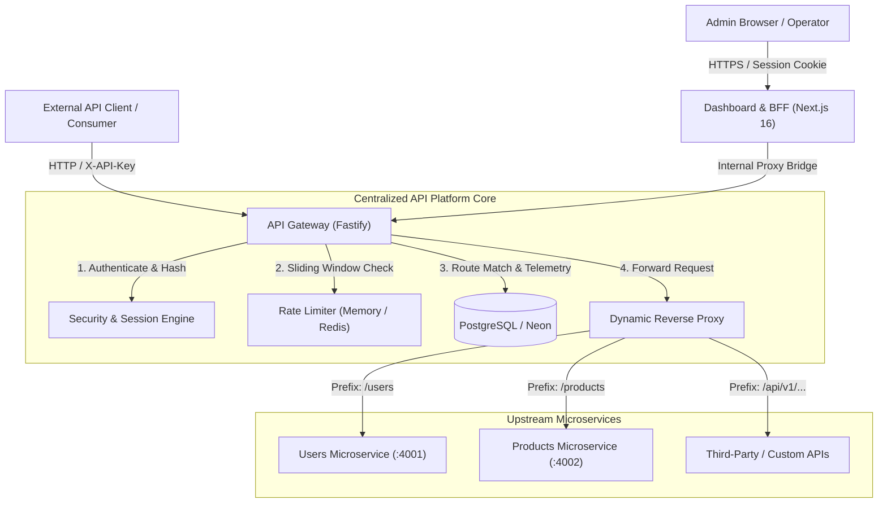
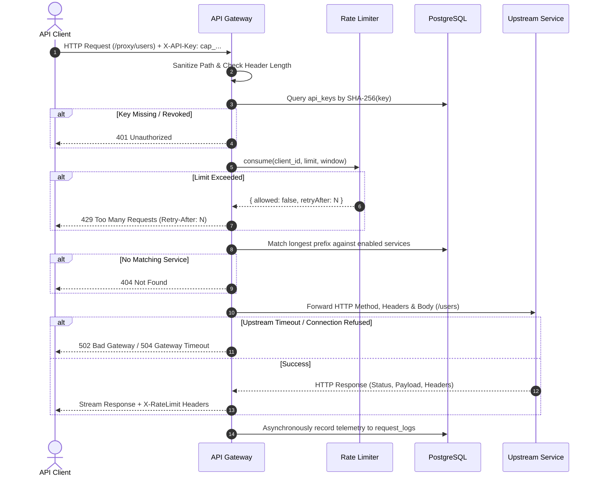
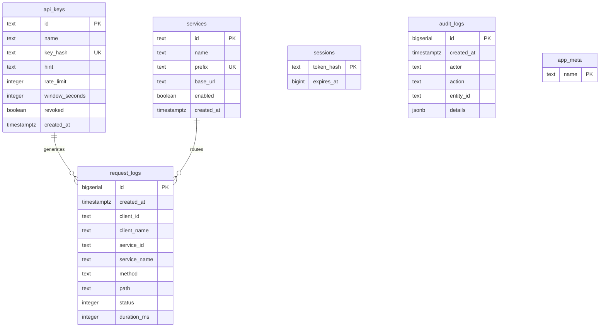

# Centralized API Management Platform

A high-performance, configuration-driven API Management Platform and Gateway engineered for microservices, featuring dynamic reverse proxying, API key lifecycle management, atomic sliding-window rate limiting, centralized request telemetry, and an administrative control plane.

Designed for seamless deployment on **Render** with external **PostgreSQL (Neon)**.

---

## 1. System Architecture Overview

The platform is architected around a decoupled, microservices-friendly topology separating the administrative control plane, reverse proxy gateway, persistence layer, and upstream backend services.



---

## 2. Core Architectural Components

### 2.1 Management Dashboard & BFF Layer (`apps/dashboard`)

- **Technology:** Next.js 16 (App Router), React 19, Tailwind CSS 4.
- **Role:** Control plane UI and Backend-For-Frontend (BFF) proxy bridge.
- **Responsibilities:**
  - Administrative interface for managing microservice registrations, issuing/revoking API keys, adjusting rate limit policies, and inspecting live request logs and audit trails.
  - Acts as a secure HTTP bridge (`/api/platform/[...path]` and `/api/gateway/[action]`), forwarding browser requests server-to-server to the internal gateway. This avoids browser cross-origin complications and prevents internal gateway topology from leaking to client browsers.
  - Implements lightweight container health check (`/health`) for Render zero-downtime orchestration.

### 2.2 Centralized API Gateway Engine (`apps/gateway`)

- **Technology:** Fastify 5.
- **Role:** High-throughput reverse proxy, traffic policy enforcer, and telemetry collector.
- **Responsibilities:**
  - **Dynamic Route Matching:** Matches incoming path prefixes using longest-prefix matching (e.g. `/users/search` takes precedence over `/users`).
  - **Path Normalization & Sanitization:** Strips `/proxy` prefix, validates URI encodings, blocks path traversal exploits (`..`, `\`, encoded `%2f`).
  - **Payload Protection:** Strict 1 MB request body limit and 2 MB upstream response streaming buffer.
  - **Status & Header Forwarding:** Transparently streams response codes, content types, and rate limit headers (`X-RateLimit-Limit`, `X-RateLimit-Remaining`, `Retry-After`).

### 2.3 Authentication, Authorization & Security Engine

- **Technology:** Node.js native `crypto` (`scryptSync`, `timingSafeEqual`, `createHash`, `randomBytes`).
- **Mechanisms:**
  - **Admin Authentication:** Constant-time `scrypt` password verification against `ADMIN_PASSWORD`. Issues cryptographically random session tokens stored as SHA-256 hashes in `sessions` table with 8-hour TTL.
  - **Cookie Security:** Enforces `HttpOnly`, `SameSite=Strict`, and dynamic `Secure` cookies based on production environment.
  - **API Key Lifecycle:** Client keys are generated as `cap_<random_bytes>` (32 bytes base64url). Raw keys are revealed **once** upon creation; only SHA-256 hashes (`key_hash`) and the last 6 characters (`hint`) are stored.
  - **CORS & Origin Isolation:** Admin mutations (`POST`, `PUT`, `DELETE`, `PATCH`) strictly enforce origin checks against configured `DASHBOARD_ORIGINS`, `FRONTEND_URL`, and Render-assigned domains (`RENDER_EXTERNAL_URL`).

### 2.4 Atomic Sliding-Window Rate Limiter (`apps/gateway/limiter.mjs`)

- **Modes Supported:**
  - **Memory Mode (Default):** Sliding-window algorithm maintaining timestamp queues per client key in-process. Self-cleaning background timer frees stale buckets every 60 seconds. Zero external dependencies.
  - **Redis Mode:** Distributed sliding-window execution running an atomic Lua script (`slidingWindow`). Executes `ZREMRANGEBYSCORE`, `ZCARD`, `ZRANGE`, and `ZADD` atomically within Redis, preventing race conditions across multiple gateway instances.

### 2.5 Relational Persistence & Data Access Layer (`apps/gateway/store.mjs`)

- **Technology:** PostgreSQL (`pg` Pool) with Neon cloud optimization, and PGlite embedded engine for zero-setup local fallback.
- **Design Principles:**
  - 100% configuration-driven via `DATABASE_URL`.
  - Native connection pooling with configurable pool size (`DATABASE_MAX_CONNECTIONS`), keepalive, and SSL validation (`DATABASE_SSL`, `DATABASE_REJECT_UNAUTHORIZED`).
  - Schema migrations run idempotently (`CREATE TABLE IF NOT EXISTS`, `CREATE INDEX IF NOT EXISTS`) on boot. Tables and existing data are **never** dropped or truncated.
  - Atomic transactions (`BEGIN` ... `COMMIT` / `ROLLBACK`) ensure configuration mutations and audit trail events are committed together.

---

## 3. End-to-End Request Lifecycle



---

## 4. Database Schema & Entity Relationships



### Table Dictionary

- `services`: Routing directory containing backend base URLs and path prefixes.
- `api_keys`: Client access credentials, policies, and cryptographic hashes.
- `sessions`: Ephemeral administrator session hashes and expiration epochs.
- `request_logs`: High-resolution HTTP proxy telemetry (latencies, status codes, endpoints).
- `audit_logs`: Immutable security audit trail recording administrative configuration changes.
- `app_meta`: Version flags preventing repeated execution of demo seed scripts across restarts.

---

## 5. Security & Isolation Architecture

1. **Zero Secret Leakage:**
   - Raw API keys are never stored in the database.
   - Session tokens are stored exclusively as SHA-256 hashes.
   - Logs never record `Authorization`, `Cookie`, or `X-API-Key` headers.
   - Request and response bodies are excluded from permanent logs to prevent PII leakage.
2. **Strict Origin & Cross-Site Request Forgery (CSRF) Mitigation:**
   - All state-altering administrative endpoints reject requests whose `Origin` header is not explicitly allowed.
   - Next.js acts as a reverse proxy shield, meaning external clients cannot directly manipulate gateway admin routes without valid session cookies.
3. **Fail-Fast Environment Validation:**
   - The platform verifies all critical environment variables (`ADMIN_PASSWORD`, `DATABASE_URL`, `PORT`) at process startup.
   - If an insecure default (such as `'local-demo-123'`) or malformed database URI is detected in production, process initialization is immediately aborted with actionable diagnostics.
4. **Hardened HTTP Response Headers:**
   - `X-Content-Type-Options: nosniff`
   - `X-Frame-Options: DENY`
   - `Referrer-Policy: strict-origin-when-cross-origin`
   - `Cache-Control: no-store`

---

## 6. Directory Structure

```
├── apps/
│   ├── dashboard/                # Next.js 16 Web Dashboard & BFF Layer
│   │   ├── app/                  # App Router UI pages & API route handlers
│   │   │   ├── api/gateway/      # Health check proxy bridge
│   │   │   ├── api/platform/     # Full CRUD proxy bridge to Gateway
│   │   │   ├── health/           # Container liveness health check
│   │   │   ├── globals.css       # Platform design system
│   │   │   ├── layout.js         # Root HTML layout
│   │   │   └── page.js           # Single-page administrative workspace
│   │   ├── next.config.mjs       # Next.js security headers & compilation rules
│   │   └── postcss.config.mjs    # PostCSS Tailwind configuration
│   └── gateway/                  # Fastify API Gateway
│       ├── app.mjs               # Route handlers, proxy logic & middleware
│       ├── config.mjs            # Centralized environment validation
│       ├── health.mjs            # Deep dependency health diagnostics
│       ├── limiter.mjs           # Memory and Redis sliding window rate limiters
│       ├── security.mjs          # Scrypt verifier, token hashing & cookies
│       ├── server.mjs            # Standalone gateway entry point
│       └── store.mjs             # PostgreSQL / PGlite data access layer
├── scripts/
│   ├── demo-check.mjs            # Automated E2E verification test script
│   ├── dev.mjs                   # Local multi-process development runner
│   ├── load-test.js              # k6 rate-limiting load test scenario
│   └── start-production.mjs      # Production process coordinator for Render
├── services/
│   ├── products/server.mjs       # Mock upstream products microservice (:4002)
│   ├── users/server.mjs          # Mock upstream users microservice (:4001)
│   └── sample-app.mjs            # Express microservice template
├── tests/
│   └── platform.test.mjs         # Automated integration and regression test suite
├── .env.example                  # Environment variable reference
├── .gitignore                    # Secrets & build artifact exclusions
├── compose.yaml                  # Local multi-container Docker Compose configuration
├── Dockerfile                    # Multi-stage production container build
├── package.json                  # Node.js project manifest and scripts
├── render.yaml                   # Render Blueprint deployment definition
└── SETUP_GUIDE.md                # Step-by-step production deployment guide
```
